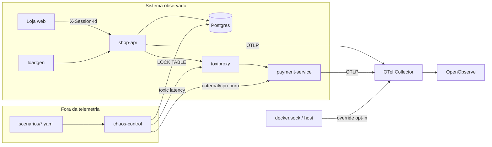

# Ambiente de referência monitorado

Loja multi-serviço instrumentada com OpenTelemetry, com falhas injetáveis
de forma determinística. Dá aos agentes do TracePilot incidentes realistas
para investigar e serve de demo do pitch. Kickoff e requisitos em
[docs/reference-environment.md](../docs/reference-environment.md).

## Arquitetura



| Componente | O que é |
|---|---|
| `shop-api` | FastAPI: loja web Apex Space, catálogo (`/products`, `/products/{id}`), cotação do carrinho (`/cart/quote`), checkout, eventos de jornada (`/rum/events`) e relato de problema (`/support/report`). |
| `payment-service` | FastAPI: autorização de pagamento com score de fraude CPU-bound. Limite de 0.5 core. |
| `postgres` | Catálogo (9 produtos), cupons `DESC10` e `GRATIS100`, pedidos e itens (`postgres/init.sql`). |
| `toxiproxy` | Proxy de rede entre shop-api e payment-service; é onde a latência é injetada. |
| `loadgen` | Tráfego de base (~2 req/s, User-Agent `tracepilot-loadgen`): vitrine, produto, cotação e checkout com 1 a 3 itens. Nunca usa o cupom `GRATIS100`. |
| `chaos-control` | Painel do apresentador. Sem OpenTelemetry: nada que ele faz aparece no OpenObserve. |

Telemetria: o `docker-compose.yml` daqui entra na rede `tracepilot` criada
pelo `docker-compose.yml` da raiz e exporta para o mesmo `otel-collector`.
Métricas de host e de containers (`host_metrics`, `docker_stats`) vêm do
override opt-in `docker-compose.hostmetrics.yml` da raiz.

## Subir

Pré-requisitos: Docker com Compose v2 e `make`.

```bash
cd demo_app
make up      # sobe OpenObserve + Collector (com override de host) e o ambiente
make ps
```

| URL | O quê |
|---|---|
| <http://localhost:8088> | Loja |
| <http://localhost:8090> | Chaos Control (painel de falhas) |
| <http://localhost:5080> | OpenObserve (`admin@tracepilot.local` / `ChangeMe123!`) |

Portas e senha do Postgres podem ser trocadas em `.env` (veja
`.env.example`). As portas são publicadas só em `127.0.0.1`.

Para derrubar: `make down` (só o ambiente) ou `make down-all` (ambiente +
telemetria). Derrube o ambiente antes da telemetria: a rede `tracepilot`
pertence ao compose da raiz.

O `postgres/init.sql` só roda com o volume vazio. Depois de mudar o schema
ou o catálogo, rode `make reset-db`: ele recria o Postgres do zero (apaga
os pedidos) e o `make up` seguinte reconstrói o shop-api.

### Loja

Front-end sem build: HTML, ES modules e CSS em `shop-api/static/`, com os
tokens do design system em `tokens.css` e as ilustrações dos produtos em
`img/products/`. A navegação é por hash:

| Rota | Tela |
|---|---|
| `#/` | Vitrine com busca, categorias e ordenação (`?q=`, `categoria=`, `ordem=`) |
| `#/produto/:id` | Página de produto |
| `#/checkout` | Entrega, forma de pagamento (Pix com 5% de desconto, cartão, boleto) e resumo |
| `#/pedido/:id` | Confirmação do pedido |

O carrinho abre em um drawer lateral e fica no `localStorage`. Frete de
R$ 29,90, grátis a partir de R$ 500. Toda falha aparece como o mesmo alerta
inline "Não consegui concluir a operação.", com o código de suporte (o
`trace_id`), botão de copiar, **Reportar problema** e **Tentar novamente**.

| Cenário | Onde o alerta aparece |
|---|---|
| `payment_latency`, `cpu_saturation` | **Finalizar pedido** no checkout |
| `db_lock` | Vitrine, página de produto, carrinho, **Aplicar** cupom e checkout |
| `coupon_bug` | **Aplicar** com o cupom `GRATIS100` (carrinho ou checkout) |

### Importar o dashboard

O dashboard [dashboards/tracepilot-investigacao.json](dashboards/tracepilot-investigacao.json)
mostra o caminho manual de investigação. Importe pela UI (Dashboards >
Import > arquivo JSON) ou pela API:

```bash
curl -u 'admin@tracepilot.local:ChangeMe123!' -H 'Content-Type: application/json' \
  -X POST http://localhost:5080/api/default/dashboards \
  --data @dashboards/tracepilot-investigacao.json
```

O formato do JSON é o da versão fixada do OpenObserve (`v1.1.2` no
`docker-compose.yml` da raiz).

## Cenários

Fonte da verdade: [scenarios/](scenarios/). Cada YAML traz categoria,
componente culpado, ativação, TTL, sinais esperados em traces, logs e
métricas, e a causa raiz de referência (gabarito) para comparar com o
diagnóstico dos agentes. A tabela abaixo é gerada a partir deles com
`make scenarios-table`.

<!-- scenarios:start -->
| Cenário | Categoria | Como ativar | TTL | Sintoma do usuário | Causa raiz (gabarito) |
|---|---|---|---|---|---|
| `coupon_bug` | code_change | `make deploy-bad` | manual | Clientes que aplicam o cupom GRATIS100 no carrinho (botão "Aplicar") recebem "Não consegui concluir a operação". Compras sem cupom ou com DESC10 funcionam. | O deploy 1.1.0 introduziu em pricing.py o cálculo do preço original a partir do total com desconto (total / (1 - desconto)). Com o cupom GRATIS100 o desconto é 100% e a divisão por zero gera ZeroDivisionError. |
| `cpu_saturation` | host_resource | Painel chaos-control | 120 s | "Finalizar pedido" fica lento e parte das tentativas termina com "Não consegui concluir a operação". Não há mensagem de erro específica. | Processos consumindo CPU dentro do container do payment-service, que tem limite de 0.5 CPU. O throttling deixa o cálculo de fraude (CPU-bound) lento e o shop-api estoura o timeout de pagamento. |
| `db_lock` | database | Painel chaos-control | 120 s | A vitrine e a página de produto não carregam; abrir o carrinho, aplicar cupom e finalizar o pedido falham com "Não consegui concluir a operação" depois de ~2 s de espera. | Uma transação de manutenção (application_name=inventory-maintenance) segura um lock ACCESS EXCLUSIVE na tabela products. As consultas do shop-api ficam bloqueadas até o statement_timeout de 2 s e são canceladas. |
| `payment_latency` (protagonista) | network | Painel chaos-control | 120 s | Todo "Finalizar pedido" termina com "Não consegui concluir a operação". Vitrine, página de produto, carrinho e cupom continuam funcionando. | Latência de 1500 ms no caminho de rede entre shop-api e payment-service (proxy de rede), acima do timeout de 1000 ms do cliente de pagamento. O payment-service está saudável; o problema é a rede entre os serviços. |
<!-- scenarios:end -->

Falhas do painel desligam sozinhas ao fim do TTL e podem ser desligadas
antes pelo botão. Ao reiniciar, o chaos-control remove qualquer falha
remanescente.

O `coupon_bug` é um deploy de verdade: `make deploy-bad` recria o shop-api
com `SHOP_VERSION=1.1.0`, o que muda o `service.version` da telemetria e
gera o log `change.event` no startup. `make deploy-good` volta para a 1.0.0.

## Roteiro do pitch (`payment_latency`)

1. Mostre a loja funcionando e o dashboard do OpenObserve com o tráfego
   normal do loadgen.
2. No Chaos Control, ligue **Latência de rede entre shop-api e
   payment-service**.
3. Na loja, abra um produto, clique em **Adicionar ao carrinho** e, no
   drawer, em **Finalizar compra**. No checkout, clique em **Finalizar
   pedido**. Aparece "Não consegui concluir a operação." com um código de
   suporte (o `trace_id`) e o botão de copiar.
4. Clique em **Reportar problema** e escreva algo vago, como um usuário real
   faria ("tentei comprar e não deu"). O relato vira o log `user.report`, com
   `session_id` e `trace_id`, e a loja mostra o protocolo do chamado.
5. Faça a investigação manual abaixo: é o trabalho que o TracePilot vai
   automatizar.
6. A falha desliga sozinha após 120 s.

### Caminho manual de investigação

1. **Relato**: painel *Relatos de usuários* traz ticket, sessão e `trace_id`.
2. **Trace do erro**: em Traces, busque o `trace_id`. O span cliente `POST`
   do shop-api dura ~1000 ms e termina em erro. O span servidor
   `POST /authorize` do payment-service, no mesmo trace, dura dezenas de ms.
3. **Logs**: em Logs, filtre `trace_id = '<id>'`. O shop-api loga
   `payment.timeout`. O payment-service loga `payment.authorized`, sem erro:
   ele respondeu, mas a resposta chegou tarde.
4. **Métricas**: no painel *Pagamento: visão do cliente x visão do
   servidor*, a linha do shop-api sobe para ~1000 ms e a do payment-service
   fica plana. No painel de CPU, o payment-service está normal.
5. **Conclusão**: o tempo se perde entre os dois serviços, ou seja, na rede.
   Confira com o gabarito em `scenarios/payment_latency.yaml`.

Backup: `cpu_saturation`. O sintoma na loja é parecido, mas o span servidor
do payment-service também fica longo e a CPU do container bate no limite de
0.5 core.

## Sinais disponíveis no OpenObserve

| Sinal | Onde | Campos úteis |
|---|---|---|
| Traces | stream `default` (traces) | `service_name`, `operation_name`, `duration` (µs), `span_status`, `service_service_version` |
| Logs | stream `default` (logs) | `event_type`, `session_id`, `trace_id`, `service_name`, `service_version`, `exception_type` |
| Métricas de app | `shop_checkout_requests`, `shop_checkout_duration`, `payment_client_duration`, `http_server_duration` | atributo `outcome` |
| Containers | `container_cpu_usage_total`, `container_memory_usage_total`, ... | `container_name` |
| Host | `system_cpu_time`, `system_memory_usage`, ... | — |

Valores de `event_type` nos logs: `change.event`, `checkout.success`,
`payment.timeout`, `payment.unavailable`, `db.unavailable`,
`unhandled.error`, `payment.authorized`, `rum.event`, `user.report`.

Valores de `rum_type` nos logs `rum.event` (jornada da loja): `page_view`,
`product_view`, `cart_add`, `cart_view`, `coupon_apply`, `checkout_view`,
`checkout_attempt`, `checkout_success`, `error_shown`, `report_opened`,
`report_sent`. O `error_shown` traz `rum_step` (onde falhou) e
`rum_trace_id` (o código mostrado ao usuário).

Para CPU de container use `rate(container_cpu_usage_total[1m]) / 1e9`
(PromQL, em cores). O `container_cpu_utilization` do `docker_stats` reporta
a média desde o start do container com Docker 29, não o uso instantâneo.

## Testes

```bash
make test   # cria .venv e roda o pytest de cada serviço com OTEL_SDK_DISABLED=true
```

## Segurança

- O override `docker-compose.hostmetrics.yml` monta `/var/run/docker.sock`
  e o filesystem do host (somente leitura) no Collector, rodando como root.
  Acesso ao socket do Docker equivale a root no host: use só em máquina
  local de desenvolvimento.
- Credenciais do Postgres e do OpenObserve são de desenvolvimento local.
- O chaos-control não tem autenticação; por isso a porta fica só em
  `127.0.0.1`.
- No WSL, `host_metrics` mede a VM do WSL, não o Windows.

## Alternativa avaliada

O [OpenTelemetry Demo (Astronomy Shop)](https://opentelemetry.io/docs/demo/)
já é instrumentado e tem feature flags de falha, mas tem cerca de 15
serviços. Para o pitch, um ambiente menor e controlável foi mais adequado.
Ele continua sendo uma opção para ampliar a variedade de cenários.
